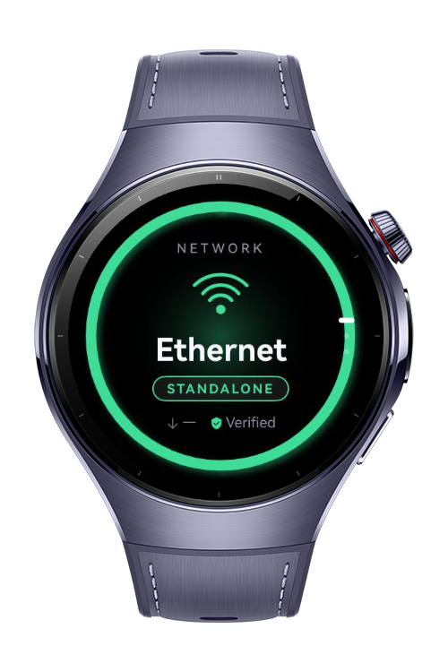
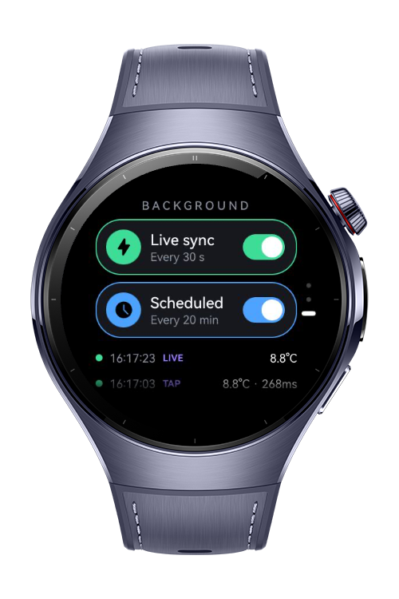
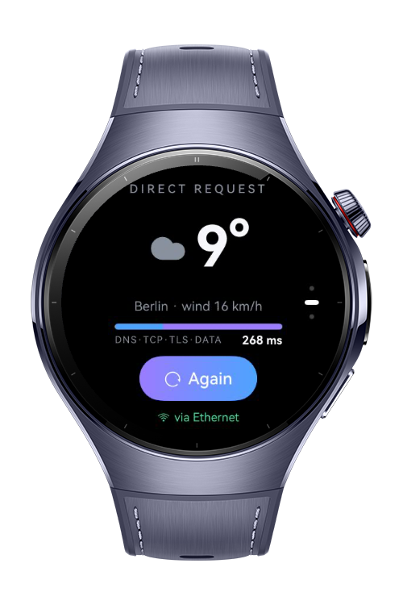

> **Note:** To access all shared projects, get information about environment setup, and view other guides, please visit [Explore-In-HMOS Index](https://github.com/Explore-In-HMOS/hmos-index).

# How to Implement Standalone Network Requests Background Tasks
This codelab shows how a HarmonyOS wearable app can go online without its paired phone and keep syncing while it is not in the foreground. You'll learn how to tell the watch's own Wi-Fi/cellular link apart from the phone's Bluetooth relay, bind the app to that standalone network for direct HTTP requests, gate every background sync on a connectivity check, and run that sync both as a continuous task and as a system-scheduled WorkScheduler job.

# Preview

<div>
  
  
  
</div>

# Use Cases

- Show the active link (Wi-Fi, cellular, or phone relay) and whether the watch is online on its own
- Send an HTTP request straight over the watch's own radio, bypassing the paired phone
- Inspect request timing (DNS, TCP, TLS, data) and the network that carried it
- Keep syncing every 30 seconds in the background with a continuous task
- Schedule a network-conditioned sync with WorkScheduler that runs even when the app is closed
- Skip syncs automatically when offline or when only the phone relay is available, and review every run in a sync log

# Tech Stack

- **Languages**: ArkTS
- **Framework**: HarmonyOS SDK 6.1.1(24)
- **Tools**: DevEco Studio 6.1.1
- **Libraries**: 
  - @kit.NetworkKit, 
  - @kit.BackgroundTasksKit, 
  - @kit.ArkData, 
  - @kit.AbilityKit, 
  - @kit.ArkUI, 
  - @kit.PerformanceAnalysisKit

# Directory Structure

```
entry/src/main/ets/
|---pages
|   |---Index.ets
|
|---network
|   |---NetworkMonitor.ets
|   |---DirectRequest.ets
|
|---background
|   |---SyncJob.ets
|   |---SyncLog.ets
|   |---ContinuousSync.ets
|   |---WorkSync.ets
|
|---workers
|   |---NetSyncWorker.ets
|
|---components
|   |---Widgets.ets
|
|---common
|   |---Constants.ets
|   |---Theme.ets
|   |---Format.ets
|
|---entryability
    |---EntryAbility.ets
```

# Constraints and Restrictions

## Supported Devices
- Huawei Watch 5

# License

**How to Implement Standalone Network Requests Background Tasks** is distributed under the terms of the MIT License. See the [LICENSE](LICENSE) for more information.
